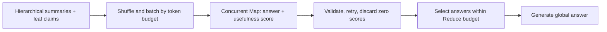

# GraphRAG Hybrid Retrieval and Evidence Grounding in TypeScript

> Repository: [sadofriod/graphrag-ts](https://github.com/sadofriod/graphrag-ts) · npm package: [@ashes_born/graph-rag-ts](https://www.npmjs.com/package/@ashes_born/graph-rag-ts)

`graphrag-ts` exposes two query paths: local retrieval uses entities, communities, and source evidence to answer specific questions; global retrieval analyzes community-summary batches and synthesizes a corpus-level answer. They share the indexed data, but not the same recall strategy.

## 1. Local Retrieval: Graph Structure Finds Topics, Chunks Find Evidence

[`GraphRAGRetrievalService`](https://github.com/sadofriod/graphrag-ts/blob/main/src/retrieval/service/GraphRAGRetrievalService.ts) first sends the query to [`parseQuery`](https://github.com/sadofriod/graphrag-ts/blob/main/src/retrieval/query/queryParser.ts) to extract entities, keywords, and themes, then uses [`entityMatcher`](https://github.com/sadofriod/graphrag-ts/blob/main/src/retrieval/entity/entityMatcher.ts) to match indexed entities. The matcher supports exact, alias, fuzzy, and semantic channels and fuses their rankings with Reciprocal Rank Fusion (RRF). The current retrieval service passes an empty alias list, so its active path uses exact, fuzzy, and semantic matching. Parsed intent entities are also merged into the results when they match known entities.

The service then builds community candidates and source evidence through separate paths:

1. Starting from matched entities, [`communityResolver`](https://github.com/sadofriod/graphrag-ts/blob/main/src/retrieval/recall/communityResolver.ts) expands through the graph by up to two hops to recall connected communities. If a community level is requested, it resolves candidates through their parent relationships to that level.
2. [`vectorSearch`](https://github.com/sadofriod/graphrag-ts/blob/main/src/retrieval/recall/vectorSearch.ts) compares the query embedding with community-summary embeddings to find semantic community candidates.
3. It searches source child chunks by vector similarity and by PostgreSQL `ILIKE` substring matches for entity names and keywords using [`keywordSearch`](https://github.com/sadofriod/graphrag-ts/blob/main/src/retrieval/recall/keywordSearch.ts). Keyword hits are sorted by matched-term count and then chunk length. The merge preserves vector-result order and deduplicates by chunk ID.

[`communityRanker`](https://github.com/sadofriod/graphrag-ts/blob/main/src/retrieval/ranking/communityRanker.ts) combines three ranked lists: summary-vector semantic rank, Jaccard overlap between query entities and community members, and the sum of graph edge weights linking query entities to community members. RRF fuses these rankings instead of directly adding incomparable cosine similarities, set ratios, and weights. The service takes `topK` results and asks the LLM filtering path in [`finalSelector`](https://github.com/sadofriod/graphrag-ts/blob/main/src/retrieval/selection/finalSelector.ts) to keep communities genuinely relevant to the question.

## 2. Local Answers Keep Summaries and Evidence Distinct

The final context has two parts: summaries from selected communities and evidence snippets. Evidence includes child chunks found by vector/keyword recall and claims associated with community member entities through [`evidenceRetriever`](https://github.com/sadofriod/graphrag-ts/blob/main/src/retrieval/evidence/evidenceRetriever.ts). Claims retain source document and source chunk IDs; child-chunk evidence also carries a chunk ID. [`answerGenerator`](https://github.com/sadofriod/graphrag-ts/blob/main/src/retrieval/answer/answerGenerator.ts) labels summaries and evidence separately before sending them to the model.

This gives community summaries the role of topic-level context, while source chunks and claims provide factual support. Neither a community ranking score nor an LLM community-filter decision is a factual confidence score. For auditing, applications should map returned evidence IDs back to source locations and expose those references.

## 3. Global Retrieval: Map-Reduce over Community Summaries

Global retrieval does not begin with entity matching. It uses leaf-community summaries by default, or summaries from a requested hierarchy level. Each selected summary is augmented with claims and available source excerpts from its descendant leaf communities, preserving evidence cues for the global analysis.

[`summaryBatcher`](https://github.com/sadofriod/graphrag-ts/blob/main/src/retrieval/global/summaryBatcher.ts) shuffles summaries, then splits and packs them against an estimated token budget. An oversized summary is divided into parts labeled with its community ID and part number. Token counting is an engineering estimate, not an exact model tokenizer. The default Map and Reduce budgets are both 8,000 tokens, with output reserves; Map concurrency defaults to four. These settings can be overridden.

Each Map batch produces an intermediate answer and a usefulness score from 0 to 100. The output is validated for JSON structure and score range, and a failed batch is retried once. Answers scored zero are excluded from Reduce. The rest are sorted by usefulness and selected one by one within the Reduce token budget. If an answer does not fit, it is skipped so a later, shorter answer can still be included. If some batches fail but usable answers remain, the result status is `partial`; if no usable result remains, the service returns a no-results status.

## 4. Choosing Between the Two Query Paths

| Query goal | Better fit | Main context |
|:---|:---|:---|
| Relations, local facts, or source support for an entity | Local | Graph neighborhood, candidate communities, relevant chunks and claims |
| Cross-topic overview, corpus trends, or synthesis | Global | Summaries at a selected level, descendant leaf claims, and Map answers |

The local path can more directly return source passages as evidence. The global path covers more topics, but the Map stage has already compressed the summaries into intermediate answers. Details in a global answer should therefore be checked against retained community and claim provenance; a Map usefulness score is not an accuracy estimate.

## 5. Request Isolation and Cancellation

The retrieval service uses namespace context to scope database queries and asynchronous local storage to propagate an optional `AbortSignal`. Database and model operations check cancellation around retrieval work so an aborted request does not keep advancing through later stages. In a multi-tenant deployment, every SQL and vector query must inherit the same namespace scope.

Related source: [`GraphRAGRetrievalService.ts`](https://github.com/sadofriod/graphrag-ts/blob/main/src/retrieval/service/GraphRAGRetrievalService.ts), [`entityMatcher.ts`](https://github.com/sadofriod/graphrag-ts/blob/main/src/retrieval/entity/entityMatcher.ts), [`communityResolver.ts`](https://github.com/sadofriod/graphrag-ts/blob/main/src/retrieval/recall/communityResolver.ts), [`vectorSearch.ts`](https://github.com/sadofriod/graphrag-ts/blob/main/src/retrieval/recall/vectorSearch.ts), [`keywordSearch.ts`](https://github.com/sadofriod/graphrag-ts/blob/main/src/retrieval/recall/keywordSearch.ts), [`communityRanker.ts`](https://github.com/sadofriod/graphrag-ts/blob/main/src/retrieval/ranking/communityRanker.ts), [`evidenceRetriever.ts`](https://github.com/sadofriod/graphrag-ts/blob/main/src/retrieval/evidence/evidenceRetriever.ts), [`answerGenerator.ts`](https://github.com/sadofriod/graphrag-ts/blob/main/src/retrieval/answer/answerGenerator.ts), [`summaryBatcher.ts`](https://github.com/sadofriod/graphrag-ts/blob/main/src/retrieval/global/summaryBatcher.ts), and [`globalMap.ts`](https://github.com/sadofriod/graphrag-ts/blob/main/src/retrieval/global/globalMap.ts).