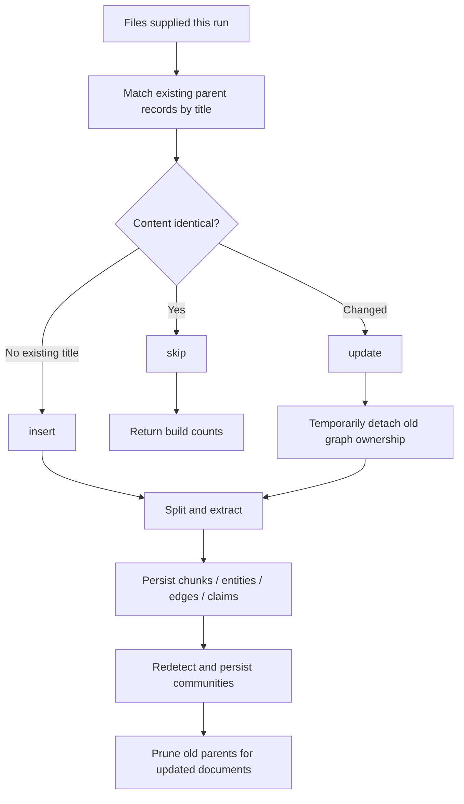

# GraphRAG Incremental Build in TypeScript: Diffing, Updates, and Pruning

> Repository: [sadofriod/graphrag-ts](https://github.com/sadofriod/graphrag-ts) · npm package: [@ashes_born/graph-rag-ts](https://www.npmjs.com/package/@ashes_born/graph-rag-ts)

This article focuses on the incremental build implementation in `graphrag-ts`, not on incremental indexing in every GraphRAG system. The main entry points are [`buildIncrementalRAG`](https://github.com/sadofriod/graphrag-ts/blob/main/src/build/buildRag/index.ts), [`startIncrementalBuild`](https://github.com/sadofriod/graphrag-ts/blob/main/src/build/startBuild.ts), and [`resolveIncrementalFiles`](https://github.com/sadofriod/graphrag-ts/blob/main/src/build/buildRag/incremental.ts).

## 1. What Does an Incremental Build Compare?

An incremental build does not scan an input directory and infer which files disappeared. The caller supplies the set of files to check, and the system compares only those files with existing parent records in the same namespace:



An old document omitted from the input is therefore not deleted automatically. Deletion is explicit through [`deleteRAGDocument`](https://github.com/sadofriod/graphrag-ts/blob/main/src/build/startBuild.ts), using a parent ID or title.

## 2. Diffing: Group by Title, Compare SHA-256 Content

[`diffDocuments`](https://github.com/sadofriod/graphrag-ts/blob/main/src/build/incremental/documentDiff.ts) queries parent records only in the current namespace and orders them by title and creation time. The comparison works in three steps:

1. **Group by title.** Markdown structure splitting can produce records named like `guide.md#Introduction`. If the current input includes `guide.md`, diffing resolves those section records to the original filename and joins their contents with newlines before comparing.
2. **Skip identical content.** The implementation first checks string equality; otherwise, it computes SHA-256 over `content.trim()`. Leading or trailing whitespace changes therefore do not trigger a rebuild, while internal content changes do.
3. **Classify as insert, update, or skip.** Untitled input is treated as a new file on every run. A changed title match carries all existing parent IDs forward for later cleanup.

```ts
const hash = new CryptoHasher('sha256')
  .update(content.trim(), 'utf8')
  .digest('hex');
```

This hash is computed by [`computeContentHash`](https://github.com/sadofriod/graphrag-ts/blob/main/src/build/incremental/documentDiff.ts). It detects content changes; it is not the document primary key and does not represent a stored version history.

## 3. Update Ordering and Why Old Graph Rows Are Detached First

If there are no files to process, the build returns empty counts. If every input is skipped, it returns the skip count without rerunning community detection. When at least one insert or update exists, the old parent IDs for updated documents are passed to [`excludeFromCommunityDetection`](https://github.com/sadofriod/graphrag-ts/blob/main/src/build/startBuild.ts): old claims have `sourceParentId` set to `null`, and old edges have `parentId` set to `null`. [`loadCommunityGraph`](https://github.com/sadofriod/graphrag-ts/blob/main/src/build/detectCommunity/graph/loadCommunityGraph.ts) reads only edges with a non-null `parentId`, so those old edges are temporarily excluded from the next detection pass.

The system then splits all files that need processing concurrently, persists their chunks, entities, edges, and claims, runs community detection and summary persistence for the namespace, and only then deletes the old parent records for updated documents. This is not limited to recomputing the few communities touched by an update: community detection runs again whenever there is work to process.

The ordering prevents both the old and new source associations from participating as active community inputs during an update. It also means the entire build is not wrapped in one database transaction. If a later stage fails before old-record pruning, some previous associations may already have been nulled; callers should account for that in retry and repair procedures.

## 4. Pruning Does Not Delete Every Related Knowledge Record

Before deleting old parents, [`pruneStaleDocuments`](https://github.com/sadofriod/graphrag-ts/blob/main/src/build/incremental/documentPruner.ts) again nulls `sourceParentId` on claims and `parentId` on edges, then deletes the parent rows. Database relations cascade-delete child chunks for those parents; claims and edges remain as rows without parent-document ownership. [`PruneDocumentResult`](https://github.com/sadofriod/graphrag-ts/blob/main/src/build/incremental/documentPruner.ts) `deletedClaims` currently returns `0` because this operation does not delete claim rows.

Edge weights need particular attention. Edges are upserted by namespace and endpoint pair, and their weights accumulate. During an update, old edges are first excluded from the community graph; if the new extraction produces the same endpoint pair, the upsert can reuse that edge and increment its weight rather than subtracting the old document's contribution exactly. The current implementation provides document-level input diffing and a rebuild flow, not a complete source-level reverse counter for edge weights. If strict per-source retraction is required, store edge instances by source or introduce a rebuildable aggregation layer.

## 5. Removing Old Documents and Working with Markdown

The incremental diff input is not a snapshot of the database: a title that is absent from the supplied files does not become a delete action. Explicit deletion uses [`deleteRAGDocument`](https://github.com/sadofriod/graphrag-ts/blob/main/src/build/startBuild.ts) with `{ title, namespace }` or its parent-ID form. Deleting by title finds every parent with that exact title, which suits a regular single-record document.

For heading-split Markdown, diffing can regroup existing `file.md#heading` parents under `file.md` for comparison. On deletion, however, confirm that the supplied title matches the persisted title shape; querying by the original filename may not find section records if each section has a distinct stored title.

## 6. Useful Counters and Test Boundaries

Build results include `insertedFiles`, `updatedFiles`, and `skippedFiles`, along with parent, edge, claim, and community counts for the run. When debugging, compare these counters independently instead of relying only on the final community count.

The repository tests cover whitespace-normalized hashes, grouping Markdown section parents, insert/update/skip classification, detaching source associations before deletion, and deleting multiple parents for one title: [`documentDiff.test.ts`](https://github.com/sadofriod/graphrag-ts/blob/main/src/build/incremental/documentDiff.test.ts) and [`documentPruner.test.ts`](https://github.com/sadofriod/graphrag-ts/blob/main/src/build/incremental/documentPruner.test.ts). Follow the implementation in [`documentDiff.ts`](https://github.com/sadofriod/graphrag-ts/blob/main/src/build/incremental/documentDiff.ts), [`documentPruner.ts`](https://github.com/sadofriod/graphrag-ts/blob/main/src/build/incremental/documentPruner.ts), [`buildRag/incremental.ts`](https://github.com/sadofriod/graphrag-ts/blob/main/src/build/buildRag/incremental.ts), [`buildRag/index.ts`](https://github.com/sadofriod/graphrag-ts/blob/main/src/build/buildRag/index.ts), and [`startBuild.ts`](https://github.com/sadofriod/graphrag-ts/blob/main/src/build/startBuild.ts).