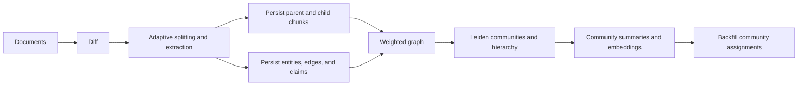

# GraphRAG TypeScript Indexing Pipeline and Incremental Updates

> Repository: [sadofriod/graphrag-ts](https://github.com/sadofriod/graphrag-ts) · npm package: [@ashes_born/graph-rag-ts](https://www.npmjs.com/package/@ashes_born/graph-rag-ts)

This article follows the actual code paths in `graphrag-ts`, from input documents to a queryable graph. These are engineering choices in this TypeScript reference implementation, not defaults that should be attributed to Microsoft GraphRAG itself.

## 1. The Indexing Pipeline



The main entry points are [`startBuild`](https://github.com/sadofriod/graphrag-ts/blob/main/src/build/startBuild.ts) and [`buildRAG`](https://github.com/sadofriod/graphrag-ts/blob/main/src/build/buildRag/index.ts). Files are split concurrently. The resulting chunks, edges, entities, and claims are persisted, after which community detection and summary persistence run over the available graph in the current namespace.

## 2. Chunking Selects a Path for the Input

In `auto` mode, [`textSplit`](https://github.com/sadofriod/graphrag-ts/blob/main/src/build/textSplit/textSplit.ts) chooses a strategy using input length and Markdown signals. The thresholds come from configuration constants:

| Input | Path | Behavior |
|:---|:---|:---|
| Short text | `deterministic` | Recursive character splitting; persist parent text and child chunks |
| Long Markdown | `markdown-structure` | Split on top-level headings, merge small sections, then smart-split each section |
| Other text | `llm` | Ask a slicing model for structured chunks, entities, edges, and claims |

Smart splitting parses the model's JSON and requires graph signals such as entities or edges. If the response is empty, unusable, or contains no graph signal, the code logs a warning and falls back to deterministic text splitting. This keeps text available for retrieval, but does not fabricate entities, edges, or claims. A successful fallback therefore does not mean graph extraction succeeded.

Each split result is persisted by [`saveChunkResults`](https://github.com/sadofriod/graphrag-ts/blob/main/src/build/textSplit/saveChunkResults.ts) with parent content and child chunks. Child chunks support local text retrieval; the persistence layer maintains their vector and full-text search fields. Parent records also anchor document-level provenance for edges and claims.

## 3. Edge Aggregation Normalizes Endpoints and Adds Weight

[`buildEdges`](https://github.com/sadofriod/graphrag-ts/blob/main/src/build/helper/buildEdges.ts) trims extracted edge endpoints and sorts them lexicographically. The implementation therefore treats an endpoint pair as an undirected connection rather than preserving relation direction. Relation descriptions are lowercased and whitespace is replaced with underscores.

Each input weight is rounded and clamped to the range 1–5; missing or non-finite values become 1. Weights are then summed for the same endpoint pair within the current batch and upserted using the database key `(namespace, sourceEntityId, targetEntityId)`. Persisted weights continue to accumulate on update.

Two consequences matter:

- The unique key excludes the relation description, so different relation labels for the same endpoint pair do not create separate edges; an update overwrites the stored description.
- Edge weight is an accumulated structural signal, not a probability that a claim is true. Re-importing without incremental diffing can also keep increasing the upserted weight.

Applications that need directed relations, multiple relation types per pair, or rebuildable source-level edge counts must change the data model or aggregation key, not merely swap the Leiden algorithm.

## 4. Leiden Detection and Strict Recursive Hierarchies

[`leidenRunner`](https://github.com/sadofriod/graphrag-ts/blob/main/src/build/detectCommunity/detection/leidenRunner.ts) converts persisted edges into a weighted graph and calls Leiden through `@graphrs/igraph-wasm`. After the top-level partition, [`communityHierarchy`](https://github.com/sadofriod/graphrag-ts/blob/main/src/build/detectCommunity/detection/communityHierarchy.ts) runs the partitioner again on each community's induced subgraph to build finer levels.

A recursive result is accepted only if it is a strict partition: at least two child communities; no duplicate members; every child member belongs to the parent; and every parent member is covered exactly once. Otherwise, the current community becomes a leaf. This protects the hierarchy from incomplete partitions, but also means some algorithm outputs will not produce deeper levels.

[`persistCommunitySummaries`](https://github.com/sadofriod/graphrag-ts/blob/main/src/build/detectCommunity/summary/persistCommunitySummaries.ts) persists community summaries bottom-up. Leaf contexts are built from entities, edges, and claims; parent contexts can include summaries already generated for their children. The implementation fingerprints community content and matches existing records, reusing unchanged summaries, updating changed ones, deleting summaries no longer in use, and then reassigning edges and claims to communities.

## 5. Incremental Builds Compare Titles and Content Hashes

The incremental entry point still uses [`buildRAG`](https://github.com/sadofriod/graphrag-ts/blob/main/src/build/buildRag/index.ts), with document-diff resolution in [`documentDiff.ts`](https://github.com/sadofriod/graphrag-ts/blob/main/src/build/incremental/documentDiff.ts) enabled. Existing parent records are matched by title, and trimmed content is hashed with SHA-256:

```text
title not found                 -> insert
title found, same content hash -> skip
title found, changed hash      -> update
```

Unchanged documents are skipped; inserted and updated documents are split again. Before an update is rebuilt, edges and claims linked to its previous parent records are excluded from community detection. New data is persisted, communities are detected again, and stale parent records are pruned. Incremental builds avoid unnecessary LLM splitting and extraction, but community detection still runs over the available graph in the namespace; this is not a local recomputation of only affected communities.

## 6. Operational Boundaries

The pipeline builds text and graph indexes together: child chunks support vector and keyword recall, entities and edges drive community detection, and claims retain factual descriptions and source pointers. When debugging, inspect fallback events, extraction counts, edge-weight changes, hierarchy depth, and summary reuse/update counts separately. The final answer alone is a poor signal for where indexing lost information.

Related source: [`startBuild.ts`](https://github.com/sadofriod/graphrag-ts/blob/main/src/build/startBuild.ts), [`buildRag/index.ts`](https://github.com/sadofriod/graphrag-ts/blob/main/src/build/buildRag/index.ts), [`textSplit.ts`](https://github.com/sadofriod/graphrag-ts/blob/main/src/build/textSplit/textSplit.ts), [`getSmartChunk.ts`](https://github.com/sadofriod/graphrag-ts/blob/main/src/build/textSplit/getSmartChunk.ts), [`buildEdges.ts`](https://github.com/sadofriod/graphrag-ts/blob/main/src/build/helper/buildEdges.ts), [`leidenRunner.ts`](https://github.com/sadofriod/graphrag-ts/blob/main/src/build/detectCommunity/detection/leidenRunner.ts), [`communityHierarchy.ts`](https://github.com/sadofriod/graphrag-ts/blob/main/src/build/detectCommunity/detection/communityHierarchy.ts), and [`documentDiff.ts`](https://github.com/sadofriod/graphrag-ts/blob/main/src/build/incremental/documentDiff.ts).