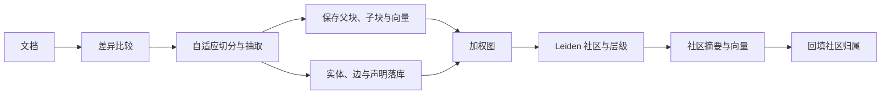

# GraphRAG TypeScript 索引管道与增量更新

> 仓库：[sadofriod/graphrag-ts](https://github.com/sadofriod/graphrag-ts) · npm 包：[@ashes_born/graph-rag-ts](https://www.npmjs.com/package/@ashes_born/graph-rag-ts)

本文根据 `graphrag-ts` 的实际代码路径，梳理从输入文档到可检索图谱的构建过程。这里介绍的是该 TypeScript 参考实现的工程选择，不应与 Microsoft GraphRAG 的默认实现细节混为一谈。

## 1. 索引管道一览



主要入口是 [`startBuild`](https://github.com/sadofriod/graphrag-ts/blob/main/src/build/startBuild.ts) 和 [`buildRAG`](https://github.com/sadofriod/graphrag-ts/blob/main/src/build/buildRag/index.ts)。多个文件的切分会并行执行；切分产物再分别持久化文本块、边、实体和声明，随后对当前 namespace 的图重新执行社区检测与摘要持久化。

## 2. 切分策略：按文档特征选择路径

[`textSplit`](https://github.com/sadofriod/graphrag-ts/blob/main/src/build/textSplit/textSplit.ts) 的 `auto` 模式按输入长度和 Markdown 特征选择策略，判断阈值来自配置常量：

| 输入情况 | 使用路径 | 行为 |
|:---|:---|:---|
| 较短文本 | `deterministic` | 递归字符切分，保存父文本与子块 |
| 较长 Markdown | `markdown-structure` | 按顶层标题分节、合并较小章节，再逐节调用智能切分 |
| 其他文本 | `llm` | 调用切片模型生成结构化块以及实体、边、声明 |

智能切分会解析模型返回的 JSON，并要求至少存在实体或边等图结构信号。若输出为空、格式不可用或没有图信号，代码会记录警告并回退到确定性文本切分。这个回退保证文本仍可进入检索索引，但不会凭空产生实体、边或声明；因此回退成功不代表知识图谱抽取成功。

每个切分结果通过 [`saveChunkResults`](https://github.com/sadofriod/graphrag-ts/blob/main/src/build/textSplit/saveChunkResults.ts) 保存父级内容和子块，子块用于局部文本检索，向量与全文检索字段由存储流程维护。父级记录还承担来源边和声明的文档级归属。

## 3. 边聚合：先规范化端点，再累加权重

[`buildEdges`](https://github.com/sadofriod/graphrag-ts/blob/main/src/build/helper/buildEdges.ts) 会先对关系抽取结果中的实体名称去除首尾空格，并按字典序排列两个端点。因而这套实现把端点对作为无向连接处理，而不是保留关系方向。关系描述会转成小写并将空白替换为下划线。

每条输入边的权重会先取整并限制在 1 到 5 之间；缺失或非有限值按 1 处理。随后，同一端点对的权重在当前批次内相加，并通过数据库的唯一键 `(namespace, sourceEntityId, targetEntityId)` upsert。持久化时权重继续累加。

这里有两个重要实现含义：

- 唯一键不包含关系描述，所以同一端点对不会因关系标签不同而变成多条边；更新时关系描述会被新值覆盖。
- 边权重是累积强度信号，不等同于事实正确概率。若重复导入没有走增量差异检查，upsert 的增量语义也可能使权重继续增长。

因此，如果应用需要有向关系、多种关系类型并存，或可重建的来源级边计数，需要调整数据模型或聚合键，而不只是替换 Leiden 算法。

## 4. Leiden 检测与严格的递归层级

[`leidenRunner`](https://github.com/sadofriod/graphrag-ts/blob/main/src/build/detectCommunity/detection/leidenRunner.ts) 将数据库边转换为加权图，并通过 `@graphrs/igraph-wasm` 调用 Leiden。顶层分区完成后，[`communityHierarchy`](https://github.com/sadofriod/graphrag-ts/blob/main/src/build/detectCommunity/detection/communityHierarchy.ts) 会在每个社区诱导出的子图上再次运行分区，尝试构建更细层级。

递归结果只有在满足严格分区条件时才会接纳为子社区：至少两个子社区；成员无重复；每个子社区成员都属于父社区；所有父成员恰好被覆盖。若不满足，当前社区就作为叶节点，不继续细分。这个校验可避免不完整分区破坏社区树，但也意味着某些算法输出不会形成更深层级。

社区摘要由 [`persistCommunitySummaries`](https://github.com/sadofriod/graphrag-ts/blob/main/src/build/detectCommunity/summary/persistCommunitySummaries.ts) 从叶节点向上持久化。叶社区上下文由实体、边和声明等内容构成；父社区上下文可加入已生成的子社区摘要。实现会计算社区内容指纹并匹配既有记录，复用未变化的摘要，更新变化项，删除本轮不再使用的摘要，最后把边和声明重新关联到社区。

## 5. 增量构建：按标题识别，再按内容哈希判定

增量入口仍走 [`buildRAG`](https://github.com/sadofriod/graphrag-ts/blob/main/src/build/buildRag/index.ts)，只是启用 [`diffDocuments`](https://github.com/sadofriod/graphrag-ts/blob/main/src/build/incremental/documentDiff.ts) 文档差异解析。代码按标题找到已有父记录，并对去除首尾空白后的文本计算 SHA-256：

```text
标题不存在                 -> insert
标题存在且内容哈希相同     -> skip
标题存在但内容哈希不同     -> update
```

未变化文档会被跳过；新增和更新文档重新切分。更新前，旧父记录关联的边和声明会先从社区检测输入中排除；新数据写入后重新检测社区，再清理过期父记录。增量更新减少了不必要的 LLM 切分与抽取，但社区检测仍针对 namespace 中当前可用的图运行，并不是只局部重算受影响社区。

## 6. 适用边界与验证

这条管道把文本检索索引和图结构索引放在同一次构建中：子块服务向量/关键词召回，实体与边驱动社区划分，声明保留事实描述与来源指针。调试时建议分别观察切分回退、抽取结果数量、边权变化、社区层级深度，以及社区摘要复用/更新数量；仅看最终答案很难定位索引阶段丢失的信息。

相关阅读源码：[`startBuild.ts`](https://github.com/sadofriod/graphrag-ts/blob/main/src/build/startBuild.ts)、[`buildRag/index.ts`](https://github.com/sadofriod/graphrag-ts/blob/main/src/build/buildRag/index.ts)、[`textSplit.ts`](https://github.com/sadofriod/graphrag-ts/blob/main/src/build/textSplit/textSplit.ts)、[`getSmartChunk.ts`](https://github.com/sadofriod/graphrag-ts/blob/main/src/build/textSplit/getSmartChunk.ts)、[`buildEdges.ts`](https://github.com/sadofriod/graphrag-ts/blob/main/src/build/helper/buildEdges.ts)、[`leidenRunner.ts`](https://github.com/sadofriod/graphrag-ts/blob/main/src/build/detectCommunity/detection/leidenRunner.ts)、[`communityHierarchy.ts`](https://github.com/sadofriod/graphrag-ts/blob/main/src/build/detectCommunity/detection/communityHierarchy.ts) 和 [`documentDiff.ts`](https://github.com/sadofriod/graphrag-ts/blob/main/src/build/incremental/documentDiff.ts)。