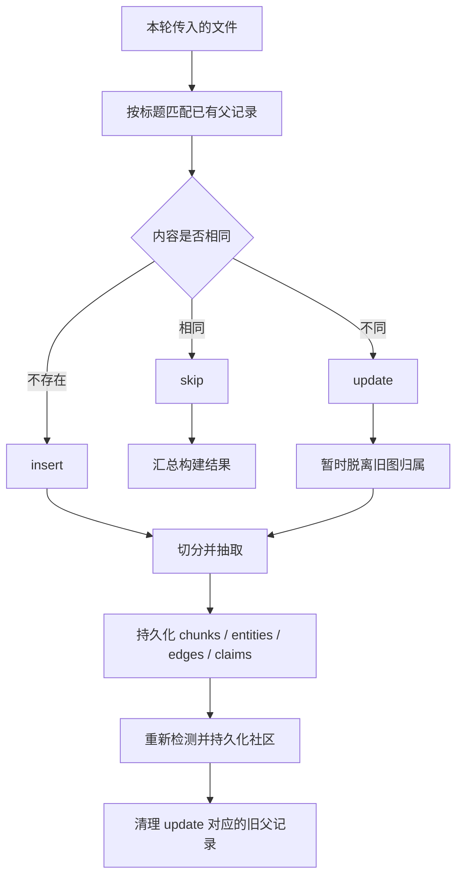

# GraphRAG 增量构建实现：差异检测、更新与清理

> 仓库：[sadofriod/graphrag-ts](https://github.com/sadofriod/graphrag-ts) · npm 包：[@ashes_born/graph-rag-ts](https://www.npmjs.com/package/@ashes_born/graph-rag-ts)

本文聚焦 `graphrag-ts` 中的增量构建实现，而不是泛指所有 GraphRAG 系统的增量索引方案。关键入口是 [`buildIncrementalRAG`](https://github.com/sadofriod/graphrag-ts/blob/main/src/build/buildRag/index.ts)、[`startIncrementalBuild`](https://github.com/sadofriod/graphrag-ts/blob/main/src/build/startBuild.ts) 与 [`resolveIncrementalFiles`](https://github.com/sadofriod/graphrag-ts/blob/main/src/build/buildRag/incremental.ts)。

## 1. 增量构建到底比较什么

增量构建不会扫描输入目录推断“哪些文件消失了”。调用方传入的是本轮要检查的文件集合，系统只把这些文件与数据库中相同 namespace 的已有父记录比较：



因此，“本轮没传入的旧文件”不会被自动删除。需要删除时，应显式调用 [`deleteRAGDocument`](https://github.com/sadofriod/graphrag-ts/blob/main/src/build/startBuild.ts)，按 parent ID 或 title 清理。

## 2. 差异判定：标题归组，内容 SHA-256

[`diffDocuments`](https://github.com/sadofriod/graphrag-ts/blob/main/src/build/incremental/documentDiff.ts) 只查询当前 namespace 的父记录，并按 title、createdAt 排序。比较逻辑分三步：

1. **按 title 归组。** 对被 Markdown 结构切分出的记录，标题可能形如 `guide.md#Introduction`。如果本轮文件集合中存在 `guide.md`，差异检测会将这些分节父记录归到原文件标题下，并按顺序用换行拼接内容后比较。
2. **相同内容跳过。** 先做字符串相等比较；不相等时，对 `content.trim()` 计算 SHA-256。因而首尾空白差异不会触发重建，内部内容变化仍会触发更新。
3. **得到 insert / update / skip。** 没有标题的输入每次都会按新文件处理；相同标题但内容改变则会带上该标题的所有旧 parent ID，以供后续清理。

```ts
const hash = new CryptoHasher('sha256')
  .update(content.trim(), 'utf8')
  .digest('hex');
```

该哈希由 [`computeContentHash`](https://github.com/sadofriod/graphrag-ts/blob/main/src/build/incremental/documentDiff.ts) 计算，用于判断内容是否变化，不是文档主键，也不代表数据库保存了唯一版本历史。

## 3. 更新的执行顺序与为何先“脱离”旧图

若没有待处理文件，构建返回空统计；若全部文件都被 skip，则直接返回跳过计数，不会重新检测社区。存在 insert 或 update 时，更新文件的旧 parent ID 会传给 [`excludeFromCommunityDetection`](https://github.com/sadofriod/graphrag-ts/blob/main/src/build/startBuild.ts)：旧 claims 的 `sourceParentId` 与旧 edges 的 `parentId` 被设为 `null`。[`loadCommunityGraph`](https://github.com/sadofriod/graphrag-ts/blob/main/src/build/detectCommunity/graph/loadCommunityGraph.ts) 只读取 `parentId` 非空的边，所以这些旧边暂时不会参与本轮社区检测。

然后系统并行切分本轮所有待处理文件，将切分结果中的文本块、实体、边和 claims 持久化，重新运行 namespace 范围内的社区检测和摘要持久化，最后才删除 update 对应的旧 parent 记录。这不是仅重算受影响的几个社区：只要本轮存在待处理文件，社区检测就会重新运行。

顺序的目的，是避免更新前的旧来源和新来源同时作为有效社区输入。它同时意味着整个构建并非一个包住所有阶段的数据库事务；如果流程在旧记录清理前失败，部分旧关联可能已被置空，调用方应把失败纳入重试和修复策略。

## 4. 删除不是删除所有相关知识

清理旧 parent 前，[`pruneStaleDocuments`](https://github.com/sadofriod/graphrag-ts/blob/main/src/build/incremental/documentPruner.ts) 会再次将 claims 的 `sourceParentId` 和 edges 的 `parentId` 置空，然后删除 parent。数据库关系会级联删除该 parent 的 child chunks；claims 与 edges 则保留为没有父文档归属的记录。[`PruneDocumentResult`](https://github.com/sadofriod/graphrag-ts/blob/main/src/build/incremental/documentPruner.ts) 的 `deletedClaims` 当前返回 `0`，因为此操作不删除 claim 行。

需要特别注意边权语义：边按 namespace 和端点对 upsert，权重采用增量累加。更新文档时旧边会先退出社区图，但若新抽取产生相同端点对，upsert 会复用该边并增加权重，而不是精确扣除旧文档的贡献。因此当前实现提供的是文档级输入差异与重建流程，不是完整的来源级边权反向计数系统。若业务要求删除某个来源后严格重算权重，需要单独保存边的来源实例或采用可重建的聚合层。

## 5. 旧文档移除与 Markdown 文档的用法

增量 diff 的输入集合不是数据库快照：缺席的标题不会生成删除动作。显式删除走 [`deleteRAGDocument`](https://github.com/sadofriod/graphrag-ts/blob/main/src/build/startBuild.ts) 的 `{ title, namespace }` 或 parent ID 版本；按 title 删除会查出该标题的全部父记录，适用于删除一个普通文档。

对按标题切分的 Markdown，差异检测能把 `file.md#heading` 的既有父记录重新组合到 `file.md` 进行比较。删除时则应确认传入的 title 与实际持久化标题形态相符；若每节使用不同 title，按原始文件 title 查询未必能命中这些分节记录。

## 6. 适合监控的计数与测试边界

构建结果包含 `insertedFiles`、`updatedFiles`、`skippedFiles`，以及本轮生成的 parent、edge、claim 和 community 数。排查异常时可分别核对这些计数，而不要只看最终社区数。

仓库测试覆盖了首尾空白哈希一致、Markdown 分节父记录归组、skip/update/insert 分类、删除前解除来源关联，以及删除某标题下多个 parent 的行为：[`documentDiff.test.ts`](https://github.com/sadofriod/graphrag-ts/blob/main/src/build/incremental/documentDiff.test.ts) 和 [`documentPruner.test.ts`](https://github.com/sadofriod/graphrag-ts/blob/main/src/build/incremental/documentPruner.test.ts)。源码入口：[`documentDiff.ts`](https://github.com/sadofriod/graphrag-ts/blob/main/src/build/incremental/documentDiff.ts)、[`documentPruner.ts`](https://github.com/sadofriod/graphrag-ts/blob/main/src/build/incremental/documentPruner.ts)、[`buildRag/incremental.ts`](https://github.com/sadofriod/graphrag-ts/blob/main/src/build/buildRag/incremental.ts)、[`buildRag/index.ts`](https://github.com/sadofriod/graphrag-ts/blob/main/src/build/buildRag/index.ts) 和 [`startBuild.ts`](https://github.com/sadofriod/graphrag-ts/blob/main/src/build/startBuild.ts)。