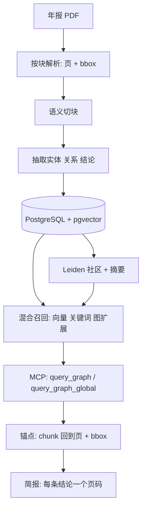

> **给买家。** 232 页年报会把决定这次会议的那个数字埋在表格里，而交到你手上的摘要没有带上它来自哪一行。这份简报让每条结论带着页码与包围盒，漏一条构建就失败——打开 S2，点供应商那一行，就落在第 36 页。

> **关键事实。** 三份 2025 年年报（宁德时代、亿纬锂能、阳光电源）进，三份报告与 36 条证据记录出，其中 29 条是事实。每条事实都要回到源 PDF 的页码与 bbox 命中，未命中则构建失败 —— 2026-11-01 实测 29/29，零遗漏。实体、结论与边进 PostgreSQL，检索沿图走而不是切一个块。三份样例报告与校验器公开。

周一早上来一个问题：这家集成商去年出货的系统，电芯到底来自哪几家，采购集中到什么程度。搜索十分钟，三份年报里都写着答案。

那为什么这个答案到了会上就不值钱？因为我没法把一句话交出去、还让对方自己核对。摘要说前五名供应商占采购四分之一，明细表说的是另一回事。两句话在同一个文件里，读的人没有办法分辨自己拿到的是哪一句。

这就是我做 `graphrag-ts` 时给自己出的题：一条结论能不能自带证据？不是给一个 232 页 PDF 的链接，不是让人回去再读一段话，而是给页码和页码上那个框，并且由写出这句话的同一条流水线产出。

这篇是一个真实案例，不是功能巡礼。三份 2025 年报进了流水线（宁德时代、亿纬锂能、阳光电源），出来三份报告、36 条证据记录，其中 29 条是事实；每条事实都必须在它标注的那一页文本层里命中，否则构建失败。

> **先验证，再往下读。** 三份样例报告已经公开，每条结论带一个证据 chip，展开是带包围盒的原文裁图：
> [S1 电芯交付对照](/work/samples/S1) ·
> [S2 储能成本剖面](/work/samples/S2) ·
> [S3 关系边与缺口](/work/samples/S3) ·
> [36 条记录原文 JSONL](/work/samples/evidence.jsonl) ·
> [源 PDF 与 2.7 MB 打包](/work/samples/) ·
> [graphrag-ts 仓库](https://github.com/sadofriod/graphrag-ts)。
> 打开 S2，点第一行供应商那个 chip，会落在第 36 页第一行。

## 一个让这条规矩变得必要的例子

阳光电源 2025 年报第 36 页有一张供应商表。英文摘要通常只留一行合计：前五名供应商 11,923,973,315.00 元，占采购额 25.12%。这句话没错。

再看明细行。第一行是「供应商一」，没有名字，6,928,853,013.03 元，14.59%。第二行明阳新能源 2.83%。第三行「供应商二」，同样匿名，2.60%。第四第五是欣旺达 2.55%、瑞浦兰钧 2.54%。第一行下面那四行加起来 4,995,120,301.97 元，也就是说一个我说不出名字的供应商，是另外四家合计的 1.39 倍。

## 流水线到底做了什么



各步在仓库里的位置：

| 步骤 | 模块 | 负责什么 |
|---|---|---|
| 切块 | `src/build/textSplit` | 智能切块，父子 chunk |
| 抽取与落库 | `src/build/buildRag` | 实体、结论、边、索引版本 |
| 社区 | `src/build/detectCommunity` | Leiden 划分、社区摘要 |
| 召回 | `src/retrieval/recall` | `vectorSearch`、`keywordSearch`、`graphExpander`、`communityResolver` |
| 排序与问句解析 | `src/retrieval/ranking`、`src/retrieval/query` | 社区排序、问句形态判断 |
| 全局路径 | `src/retrieval/global` | 摘要上的 map 与 reduce |
| 锚点 | `src/retrieval/evidence` | `pageAnchor`、`evidenceRetriever` |
| 对外接口 | `integrations/mcp` | `submit_index_job`、`get_index_job`、`query_graph`、`query_graph_global` |

## 第 1 步：解析必须留住页和框

上面每一条事实都是表格单元格。把第 36 页压成一段话的解析器，会让你看到一个「供应商一」挨着一个属于别的行的数字，而且分不出来，因为两个数字都是真的。

所以解析输出的是块：文本、页、包围盒，每个内容块在 markdown 旁边留一条提示注释。

```html
<!-- page 36 bbox=114.62,357.05,533.55,366.05 -->
```

切块会重排文本、把这些注释丢掉，这没关系，因为锚点可以靠文本反查回来。先用精确子串包含；切块改过边界、精确匹配失败时，用字符 bigram Dice 在最多三个块的滑窗上打分，下限 0.55。一份年报切 218 个 chunk：147 个精确、71 个模糊、0 个无归属。方法跟着 chunk 一起落库，所以记录会告诉你看到的是哪一种。

丢列表头的代价在上一页就能看见。第 35 页成本表写着储能行业原材料 20,216,949,877.11、33.25%，接着是 13,907,695,693.24、25.50%。33.25% 是营业成本总额里的占比，不是储能分部内部的占比。表头一丢，你写出的那句话每位数字都是真的，算术是错的。

## 第 2 步：实体、结论、边

最终交付的单位是结论，一条结论就是一行记录：

- `statement`，一句话，不带形容词；
- `kind`，`fact` / `calc` / `inference` 三选一；
- 事实要有 `doc`、`page`、`quote`，quote 是原文，不是翻译；
- calc 与 inference 要有 `basis`，写明由哪几条结论推出来；
- `confidence`，以及非事实条目必须写清「什么情况下这条会错」。

实体之间的边是两个名字、一个关系、至少一个锚点。没有锚点的边画虚线，并在报告里算作缺口，不允许它长得和别的边一样。

这条规矩是我最在意的。全部边都画实线的图，没人能查。

样例里三条链，每条都能落到一页：

- 亿纬锂能第 16 页点名储能客户：Wärtsilä、ABB、台达电子、中国移动、南方电网、沃太能源。只有名字，没有金额。
- 宁德时代第 22 页说与海博思创、中车株洲所、思源电气达成长期战略合作。原文写的是战略合作，记录就写战略合作，不升级成供货协议。
- 阳光电源第 36 页的供应商表里点名欣旺达、瑞浦兰钧，带金额。

再往外两跳：阳光电源第一大客户 Algihaz Contracting，4,010,035,531.92 元，占销售 4.50%，第 36 页；沙特 7.8GWh 项目期内全容量并网，第 28 页。

## 第 3 步：检索沿图走，这才是重点

这一步决定了它是 GraphRAG 而不是「带引用的分块搜索」，所以说清楚两条路径各自干了什么。

`query_graph` 是局部路径。问句解析先抽实体，`vectorSearch` 与 `keywordSearch` 并行打 chunk，`graphExpander` 把命中实体的邻居拉进来，`communityResolver` 找到这些实体所属的社区，`communityRanker` 排序。答案从实体邻域拼出来，不是从 top-k 分块里拼出来。

`query_graph_global` 是 map-reduce 路径。按选定层级取社区摘要，按 token 预算分批，每批问一次模型并给有用性打分，最后 reduce 留下来的部分。这条路径回答的是「这个语料在 X 上到底说了什么」这类跨文档问题，答案不在任何一个分块里。

两条路径都返回带 `sourceDocumentId`、`sourceChunkId` 的证据条目；接了锚点层之后，还会带 `page`、`pageEnd`、`bbox`、`anchorMethod`。最后这个字段不是装饰：`exact` 和 `fuzzy` 在「这条引用能信多少」这件事上含义不同。

## 第 4 步：锚点解得出来，或者构建失败

每一条 `fact`，校验器取文档和页码，把那一页所有块的文本拼接去空白，然后找 quote 是否是子串。命中：把覆盖到的块的包围盒取并集，按 2 倍渲染该页，上下各留 40 px、左右各留 20 px 裁图。没命中：打印 `MISS`，进程以非零退出。

三份报告的结果：

```text
S1: facts=8  hits=8  misses=0
S2: facts=10 hits=10 misses=0
S3: facts=11 hits=11 misses=0
TOTAL: facts=29 hits=29 misses=0
```

没有警告态。一条在它写的那一页找不到的结论不许出厂，所以结论数量由文本层能证明的东西决定，不由报告该写多长决定。每条记录还带 PDF 的 SHA256 和 `verified_at` 时间戳，这样裁图是针对那一份具体文件可复现的，而不是针对「那份年报」这个模糊说法。

## 一条结论从表里到简报上

`s2-4`，类型 `fact`：第一供应商「供应商一」，6,928,853,013.03 元，占采购 14.59%，第 36 页，置信度 0.98。备注写明这一行是匿名的，不得推断成任何一家具体电芯厂。chip 打开 `anchors/s2-4.png`，那一行被框住。

`s2-11`，类型 `calc`：2.55% + 2.54% = 5.09%，约为 14.59% 的三分之一，比值 2.87。依据 `s2-4`、`s2-5`、`s2-6`，备注写正负 0.02 个点的容差，因为两个四舍五入的百分比相加。

`s2-12`，类型 `inference`，置信度 0.4：如果那家 14.59% 的供应商是电芯厂，那么采购集中在一家对手方身上，具名的第二、第三来源属于补量。备注写这条无法用公开年报闭环，不得用来支撑单一供应商结论。

| 报告 | 文档 | 页数 | 事实 | 计算 | 推断 |
|---|---|---|---|---|---|
| S1 电芯交付对照 | 300750、300014 | 232、222 | 8 | 1 | 2 |
| S2 储能成本剖面 | 300274 | 230 | 10 | 1 | 1 |
| S3 关系边与缺口 | 三份 | 232、230、222 | 11 | 0 | 2 |

## 图在这里给了什么，没给什么

给的是两跳问题。「这家集成商的电芯供应商，它的母公司是不是同时供货给组件厂」，这是边走，不是相似度搜索。边带了锚点之后，走的每一步都带着支撑它的那一页。

这份语料上没给的是社区检测。三份文档、三家公司，划分几乎不决定任何事，我在意的边一张表就放得下。Leiden 要到几百份文档才值这个成本，三份不是。全局路径是实现了也测过的，只是在这套语料上它产出的是三份年报的摘要，不值那点 token。

还有一条更影响商业价值的边界：年报能证明关系存在，证明不了金额。供应商表是拿掉名字之后的采购占比，所以「谁家的电芯装进了谁家的集成商、多少量」在年报里根本问不出来。要海关记录、招标结果、环评许可，或者一次供应商访谈。

三份文档也不算语料。四个实体、五条边，就是一张画了箭头的表。它值得交付的原因只有一个：每条边带着页码，每条缺失的边写清为什么缺。

## 什么情况下别用它

- **PDF 是扫描件。** 没有文本层，没有子串命中，没有锚点。我的样例语料里一份都没有，所以这种情况我没有任何实测行为可讲。要 OCR，而且结论会弱得多。
- **你要的是金额，不是存在性。** 见上一节。
- **你要预测。** 这里的推断条目置信度在 0.4 到 0.6 之间，都标了。如果决策要落在 2026 年的量上，这份简报是输入，不是答案。
- **一份文档就能回答。** 那就去读第 36 页。为一条只有一页证据的问题建图是多余动作。
- **买方要的是一通电话。** 五天的解析打不过一通三十分钟、对方本来就懂这个行业的电话。

## 样例、试用与仓库

2.7 MB 的包（三份 PDF、三份 HTML 报告、`evidence.jsonl`）在 [/work/samples/](/work/samples/)。想在你真正跟踪的公司上出一份这样的报告，发邮件到 [justlikeashes@gmail.com](mailto:justlikeashes@gmail.com)，写清公司和你想先核的那一条结论。如果语料撑不住，我会直接说撑不住，而不是围着它写一份报告。

`graphrag-ts` 是 MIT 许可，Bun 或 Node 加 PostgreSQL/pgvector 就能跑。MCP 试用写在这篇 [GraphRAG-ts MCP 试用说明](/blog/graphrag-mcp-trial-zh)里：预先建好索引的工作区、只读查询、带页码锚点的来源片段。锚点层在仓库 `src/retrieval/evidence` 下面。上面那个跑出 29/29 的校验器还没公开，所以这个数暂时是我负责解释，不是你负责复现。

## 相关

- [免费 DOI 撤稿查询与 CC0 引用图谱](https://ashesborn.cloud/datasets)
- [案例：Evidence Brief](https://ashesborn.cloud/work/evidence-brief)
- [graphrag-ts 仓库](https://github.com/sadofriod/graphrag-ts)
