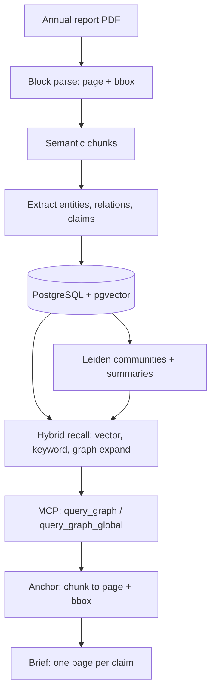

> **Key facts.** Three 2025 annual reports (CATL, EVE Energy, Sungrow) in; three reports and 36 evidence records out, 29 of them facts. Every fact resolves to a page and bounding box in the source PDF and the build exits non-zero on a miss — 29 of 29 verified, 0 misses, 2026-11-01. Entities, claims and edges land in PostgreSQL; retrieval walks the graph instead of one chunk. The three sample reports and the verifier are public.

A supply chain question lands on a Monday. Which cell makers sit behind the systems this
integrator shipped last year, and how concentrated is the buying. Ten minutes of search and I have
three annual reports that contain the answer.

So why is that answer still useless in a meeting? Because I cannot hand someone a sentence and let
them check it. A summary says the top five suppliers are a quarter of procurement. The table says
something else. Both are in the same file, and the reader has no way to tell which one they were
given.

That is the question I built `graphrag-ts` around: can a claim carry its own proof? Not a link to a
232 page PDF, not a paragraph someone has to re-read, but the page and the box on the page, produced
by the same pipeline that wrote the sentence.

This post is a worked case, not a feature tour. Three 2025 annual reports went through the pipeline
(CATL, EVE Energy, Sungrow). Out came three reports and 36 evidence records, 29 of them facts, and
every fact had to hit the PDF text layer at the page it names or the build exits non-zero.

> **Check it before you read the rest.** The three sample reports are public, each with evidence
> chips that open the cropped source text and its bounding box:
> [S1 storage cell delivery](/work/samples/S1) ·
> [S2 storage cost profile](/work/samples/S2) ·
> [S3 relation edges](/work/samples/S3) ·
> [all 36 records as JSONL](/work/samples/evidence.jsonl) ·
> [the source PDFs and the 2.7 MB bundle](/work/samples/) ·
> [graphrag-ts on GitHub](https://github.com/sadofriod/graphrag-ts).
> Open S2, click the chip on the first supplier row, and you land on page 36, row one.

## The example that made the rule necessary

Page 36 of Sungrow's 2025 annual report has a supplier table. The line most English summaries keep
is the total: top five suppliers are 11,923,973,315.00 yuan, 25.12% of procurement. That sentence is
true.

The rows say something else. Row one is `供应商一`, no name, 6,928,853,013.03 yuan, 14.59%. Row two
is 明阳新能源 at 2.83%. Row three is `供应商二`, also unnamed, 2.60%. Rows four and five are 欣旺达
at 2.55% and 瑞浦兰钧 at 2.54%. The four rows under the first one add up to 4,995,120,301.97 yuan,
so one supplier I cannot name is 1.39 times the other four combined.

## What the pipeline actually does



Where each step lives, in the repository:

| Step | Module | What it holds |
|---|---|---|
| chunking | `src/build/textSplit` | smart chunking, parent and child chunks |
| extraction and persistence | `src/build/buildRag` | entities, claims, edges, index version |
| communities | `src/build/detectCommunity` | Leiden partition, community summaries |
| recall | `src/retrieval/recall` | `vectorSearch`, `keywordSearch`, `graphExpander`, `communityResolver` |
| ranking and query parsing | `src/retrieval/ranking`, `src/retrieval/query` | community ranker, query shape detection |
| global path | `src/retrieval/global` | map and reduce over summaries |
| anchors | `src/retrieval/evidence` | `pageAnchor`, `evidenceRetriever` |
| agent surface | `integrations/mcp` | `submit_index_job`, `get_index_job`, `query_graph`, `query_graph_global` |

## Step 1. The parse has to keep the page and the box

Every fact in the brief above is a table cell. A parser that flattens page 36 hands you a paragraph
where `供应商一` sits next to a number that belongs to a different row, and you cannot tell, because
both numbers are real.

So the parse emits blocks: text, page, bounding box, one hint comment per content block next to the
markdown.

```html
<!-- page 36 bbox=114.62,357.05,533.55,366.05 -->
```

The chunker reorganises text and drops those comments, which is fine, because the anchor is
recovered by matching the chunk text back to the blocks. Exact substring containment first. When the
chunker has rewritten a boundary, a character bigram Dice score over sliding windows of up to three
blocks, floor 0.55. On a 218 chunk cut of one annual report: 147 exact, 71 fuzzy, 0 unattributed.
The method travels with the chunk, so the record says which of the three you are looking at.

The cost of losing the column header shows up one page earlier. The operating cost table on p.35
reads 储能行业 原材料 20,216,949,877.11, 33.25%, and then 13,907,695,693.24, 25.50%. The 33.25% is
the share of total operating cost, not the share inside the storage segment. Drop the header and you
write a sentence where every digit is real and the arithmetic is wrong.

## Step 2. Entities, claims, edges

The unit that ships is a claim, and a claim is a row:

- `statement`, one sentence, no adjectives;
- `kind`, one of `fact`, `calc`, `inference`;
- for a fact: `doc`, `page`, `quote`, the quote being the original characters rather than a
  translation;
- for a calc or an inference: `basis`, the claim ids it was derived from;
- `confidence`, and for anything that is not a fact, a note saying what would make it wrong.

An edge between two entities is two names, a relation, and at least one anchor. An edge with no
anchor is drawn dashed and counted as a gap. It never gets to look like the others.

That last rule is the one I care about. A graph where every edge is solid is a graph nobody can
check.

Three chains in the sample set, all of them one page each:

- EVE Energy names its storage customers at p.16: Wärtsilä, ABB, 台达电子, 中国移动, 南方电网,
  沃太能源. Names only, no amounts.
- CATL says at p.22 that it reached long term strategic cooperation with 海博思创, 中车株洲所 and
  思源电气. The source says strategic cooperation, so the claim says strategic cooperation. It does
  not get upgraded to a supply agreement.
- Sungrow names 欣旺达 and 瑞浦兰钧 in its supplier table at p.36, with amounts.

Two hops outward: Sungrow's first customer is Algihaz Contracting, 4,010,035,531.92 yuan, 4.50% of
sales, p.36, and the 7.8 GWh Saudi project reached full grid connection in the period, p.28.

## Step 3. Retrieval walks the graph, and that is the whole point

This is the part that makes it GraphRAG rather than a chunk search with citations, so it is worth
being specific about what each path does.

`query_graph` is the local path. The query parser pulls entities out of the question, `vectorSearch`
and `keywordSearch` run in parallel over chunks, `graphExpander` pulls the neighbours of the matched
entities, `communityResolver` finds the communities those entities belong to, and
`communityRanker` orders them. The answer is assembled from the entity neighbourhood, not from the
top k chunks.

`query_graph_global` is the map reduce path. It walks community summaries at a chosen level,
batches them by token budget, asks the model one question per batch, scores usefulness, and reduces
what survives. This is the path for "what does this corpus say about X across documents", where the
answer is not in any single chunk.

Both paths return evidence items with `sourceDocumentId`, `sourceChunkId` and, since the anchor
layer, `page`, `pageEnd`, `bbox` and `anchorMethod`. That last field is not decoration: `exact` and
`fuzzy` mean different things when you are deciding how much to trust a citation.

## Step 4. The anchor resolves, or the build fails

For every `fact`, the verifier takes the document and the page, joins that page's block text,
strips whitespace, and looks for the quote as a substring. Hit: union the bounding boxes of the
covered blocks, render the page at scale 2, crop with 40 px of padding above and below, 20 px at the
sides. Miss: print `MISS` and exit non-zero.

On the three reports:

```text
S1: facts=8  hits=8  misses=0
S2: facts=10 hits=10 misses=0
S3: facts=11 hits=11 misses=0
TOTAL: facts=29 hits=29 misses=0
```

There is no warning state. A claim that cannot be found on the page it names does not ship, which
means the number of claims is set by what the text layer can prove, not by how long the report
should be. Each record also carries the PDF's SHA256 and a `verified_at` timestamp, so the crop is
reproducible against that exact file instead of against "the annual report" in general.

## One claim, end to end

`s2-4`, kind `fact`: the first supplier is `供应商一`, 6,928,853,013.03 yuan, 14.59% of
procurement, p.36, confidence 0.98. The note says the row is anonymous and must not be inferred to
be any particular cell maker. The chip opens `anchors/s2-4.png`, that row highlighted.

`s2-11`, kind `calc`: 2.55% plus 2.54% is 5.09%, roughly a third of 14.59%, ratio 2.87. Basis
`s2-4`, `s2-5`, `s2-6`, with a plus or minus 0.02 point tolerance in the note, because two rounded
percentages were added.

`s2-12`, kind `inference`, confidence 0.4: if the 14.59% supplier is a cell maker, then procurement
concentrates on one counterparty and the named second and third sources are top ups. The note says
this cannot be closed from public annual reports and must not be used to support a single supplier
conclusion.

| report | documents | pages | fact | calc | inference |
|---|---|---|---|---|---|
| S1 storage cell delivery | 300750, 300014 | 232, 222 | 8 | 1 | 2 |
| S2 storage cost profile | 300274 | 230 | 10 | 1 | 1 |
| S3 relation edges | all three | 232, 230, 222 | 11 | 0 | 2 |

## What the graph gives you here, and what it does not

What it gives: the two hop question. "Which integrator buys cells from a supplier whose parent also
sells to the module vendor" is an edge traversal, not a similarity search. Once the edges carry
anchors, the traversal answer arrives with the page that justifies each hop.

What it does not give, on this corpus: community detection. On three documents and three companies
the partition decides almost nothing, and the edges I care about fit in one table. Leiden earns its
cost at a few hundred documents. I am not going to pretend three is that. The global path is
implemented and tested, and on this corpus it produces a summary of three annual reports, which is
not worth the tokens.

There is a second limit that matters more commercially. The reports prove that relations exist.
They do not price them. Supplier tables are percentages of procurement with the names replaced, so
"how much of whose cells went into whose integrator" cannot be answered from annual reports at all.
Customs records, tender results, environmental permits, a supplier interview: different sources.

Three documents is also not a corpus. Four entities and five edges is a table with arrows drawn on
it. What makes it worth shipping is that each edge carries a page, and each missing edge is named
with the reason it is missing.

## When this is the wrong tool

- **The PDF is a scan.** No text layer, no substring hit, no anchor. My sample corpus contains none,
  so I have no measured behaviour for that case. It would need OCR and a much weaker claim.
- **You need an amount, not an existence.** See above.
- **You want a forecast.** Inference rows here carry 0.4 to 0.6 and are marked. If the decision
  needs a call on 2026 volumes, this brief is an input, not the answer.
- **One document answers it.** Then read page 36. Building a graph for a question with one page of
  evidence is overhead.
- **The buyer wants a conversation.** Five days of parsing does not beat a thirty minute call with
  someone who already knows the industry.

## Trial, samples and the repository

The 2.7 MB bundle (three PDFs, three HTML reports, `evidence.jsonl`) is at
[/work/samples/](/work/samples/). If you want a report like this on a company you actually track,
reply to [justlikeashes@gmail.com](mailto:justlikeashes@gmail.com) with the company and the claim
you would want checked first. If the corpus cannot support it, I will say so rather than ship a
report around it.

`graphrag-ts` is MIT licensed and runs on Bun or Node with PostgreSQL plus pgvector. The MCP trial
is described in [the GraphRAG-ts MCP post](/blog/graphrag-mcp-trial): a pre-indexed workspace,
read-only queries, source excerpts with page anchors. The anchor layer is in the repository under
`src/retrieval/evidence`. The verifier that printed 29 of 29 above is not published yet, so that
number is mine to defend, not yours to re-run.

## Related

- [Free DOI retraction lookup and CC0 citation graph](https://ashesborn.cloud/datasets) — the same graph, addressable per DOI
- [Case study: Evidence Brief](https://ashesborn.cloud/work/evidence-brief) — the deliverable this pipeline produces
- [graphrag-ts on GitHub](https://github.com/sadofriod/graphrag-ts)
